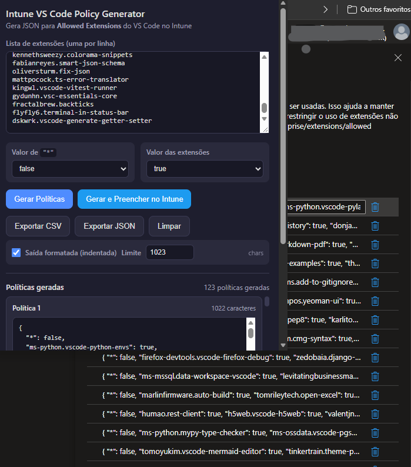

# Intune VS Code Policy Generator

Extensão para **Chrome / Edge** (Manifest V3) que gera o JSON de configuração
**Allowed Extensions** do VS Code para o **Microsoft Intune**, dividindo
automaticamente a lista de extensões em blocos com limite configurável, cujo
padrão é **1023 caracteres**.



## Funcionalidades

- Cole a lista de extensões (uma por linha)
- Configure o valor da chave `"*"` (true/false) e o valor das extensões (true/false)
- **Gerar Políticas** — divide a lista respeitando o limite definido no popup (padrão: 1023 caracteres)
- **Copiar JSON** em cada política gerada
- **Exportar CSV** / **Exportar JSON**
- **Gerar e Preencher no Intune** — via Content Script, preenche automaticamente o formulário Intune quando você estiver na tela de configuração
- Atalho: `Ctrl+Enter` dentro do textarea gera as políticas

## Como instalar

### Chrome

1. Abra `chrome://extensions/`
2. Ative o **modo de desenvolvedor** (interruptor no canto superior direito)
3. Clique em **Carregar sem compactação**
4. Selecione a pasta `GerarPolíticaVsCode`
5. Pronto! Pelo ícone da extensão, abra o popup e cole a lista de extensões.

### Edge

1. Abra `edge://extensions/`
2. Ative o **modo de desenvolvedor** (à esquerda)
3. Clique em **Carregar descompactada**
4. Selecione a pasta `GerarPolíticaVsCode`

## Formato de saída

Cada política gerada tem o seguinte formato (aceito pelo Intune no campo
**Allowed Extensions**):

```json
{
  "*": true,
  "ms-python.python": false,
  "ms-python.vscode-pylance": false,
  "eamodio.gitlens": false
}
```

### Valores configuráveis

Antes de gerar, você pode escolher os valores dos dois campos:

| Campo | Opções | Descrição |
|-------|--------|-----------|
| **Valor de `"*"`** | `true` / `false` | Valor da chave `*` (padrão: `true`) |
| **Valor das extensões** | `true` / `false` | Valor padrão aplicado a cada extensão da lista (padrão: `false`) |

Exemplos de combinações:

```json
// "*": true, extensões: false (padrão)
{ "*": true, "ms-python.python": false }

// "*": false, extensões: false (bloquear tudo)
{ "*": false, "ms-python.python": false }

// "*": true, extensões: true
{ "*": true, "ms-python.python": true }

// "*": false, extensões: true (permitir apenas por usuário)
{ "*": false, "ms-python.python": true }
```

- `"*": true` — permite a lista de extensões configurada
- `"*": false` — bloqueia por padrão tudo que não estiver explicitamente permitido
- `"ext": false` — bloqueia a extensão específica
- `"ext": true` — permite a extensão específica

A lista é dividida em políticas cujo JSON indentado, como exibido no popup,
não ultrapassa o limite configurado pelo usuário (padrão: **1023 caracteres**).
A configuração `"*"` é repetida em cada política gerada.
A documentação geral do Intune alerta que alguns campos podem ter limite de
caracteres, mas não confirma o valor de 1023 para esta configuração: [Settings
Catalog](https://learn.microsoft.com/en-us/intune/device-configuration/settings-catalog/).

## Uso no Intune (Administrative Templates)

1. No Intune, acesse **Devices → Configuration** e abra ou crie o perfil Windows que usa **Administrative Templates**.
2. Em **Configuration settings → All Settings**, localize **Visual Studio Code → Extensions → AllowedExtensions**.
3. Abra **AllowedExtensions** e habilite a política.
4. Para o preenchimento manual, cole cada política gerada em um campo separado. Confirme cada campo pelo botão de marca de seleção; o Intune adiciona o próximo campo.
5. Salve o perfil.

## Uso automático (Content Script)

1. Gere as políticas no popup
2. Certifique-se de estar logado no **Microsoft Intune admin center**.
3. Abra a política **AllowedExtensions** do VS Code em **Administrative Templates** e deixe o painel da configuração aberto.
4. No popup, clique em **Gerar e Preencher no Intune**. A extensão preenche e confirma cada política, aguardando o Intune criar o campo seguinte.
5. Revise os campos preenchidos e salve o perfil no Intune.

> **Observação**: O Intune usa editores dinâmicos baseados em Monaco e sua
> interface pode mudar. O content script tenta vários seletores comuns.
> Se o preenchimento automático não funcionar, use o modo **manual**
> (copiar e colar cada política).

## Estrutura de arquivos

```
GerarPolíticaVsCode/
├── manifest.json          → Declaração da extensão (MV3)
├── popup.html             → Interface do popup
├── popup.js               → Lógica da interface (copiar/exportar)
├── styles.css             → Estilos
├── GerarPoliticaVSCode.js → Lógica de divisão por limite configurável
├── contentScript.js       → Preenchimento automático no Intune
├── generate_icons.ps1     → Script para (re)gerar os ícones PNG
└── icons/                 → Ícones da extensão (16, 48, 128)
```

## Limitações

- É necessário estar logado no Intune para o preenchimento automático
- A tela do Intune pode variar entre locatários; os seletores do content
  script podem precisar de ajustes

## Licença

Este projeto é distribuído sob a licença MIT. Consulte [LICENSE](LICENSE) para os termos completos.